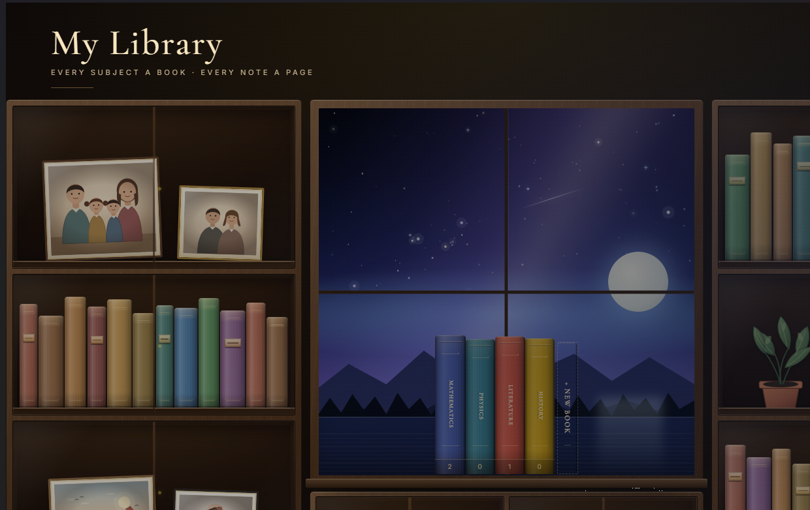
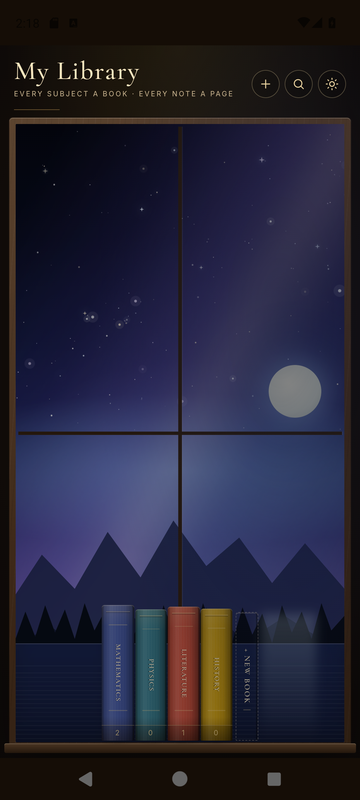
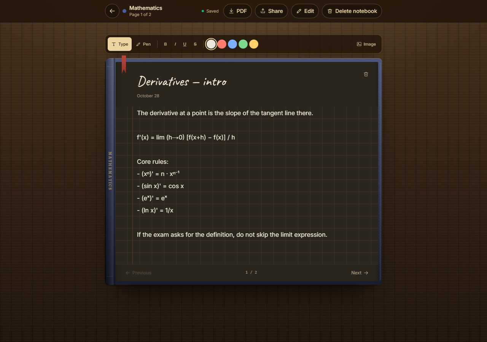
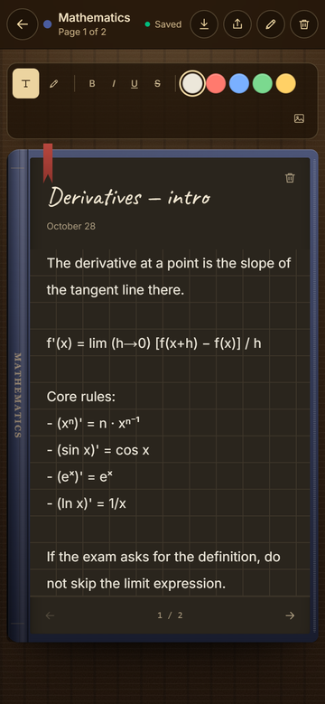

# My Library

Every subject a book, every note a page.

A notebook for class notes that lives on a library shelf. No account required;
everything runs on your device. Subjects become book spines, and each spine
grows thicker as you add pages.

[Open the web app](https://my-library-pi-one.vercel.app) ·
[Download the latest release](https://github.com/olcanaskar/my-library/releases/latest)

## Screenshots

| Desktop library | Android library |
|:---:|:---:|
|  |  |

| Desktop note editor | Mobile note editor |
|:---:|:---:|
|  |  |

## Download

| Platform | File | Notes |
|---|---|---|
| Windows 10+ | [MyLibrary-0.1.0-portable.exe](https://github.com/olcanaskar/my-library/releases/download/v0.1.0/MyLibrary-0.1.0-portable.exe) | Portable; unsigned |
| macOS 13+ | [MyLibrary-0.1.0-mac-universal.dmg](https://github.com/olcanaskar/my-library/releases/download/v0.1.0/MyLibrary-0.1.0-mac-universal.dmg) | Intel + Apple Silicon; not notarized |
| Android 7+ | [MyLibrary-0.1.0-debug.apk](https://github.com/olcanaskar/my-library/releases/download/v0.1.0/MyLibrary-0.1.0-debug.apk) | Debug-signed; sideload only |
| Web | [Open in browser](https://my-library-pi-one.vercel.app) | No install required |

All releases, checksums and release notes:
[Releases](https://github.com/olcanaskar/my-library/releases).

## Install

### Windows

1. Download and run the `.exe`.
2. If SmartScreen appears, choose **More info → Run anyway**.
3. No installer is needed; move the file anywhere you like.

### macOS

1. Open the `.dmg`.
2. Drag **My Library** into the Applications folder.
3. On first launch, right-click the app → **Open**.

The macOS build is ad-hoc signed but not notarized by Apple. If Gatekeeper still
blocks it, run:

```bash
xattr -cr "/Applications/My Library.app"
```

### Android

1. Download the `.apk`.
2. Allow installing from unknown sources on your phone.
3. Open the APK and install.

The APK is debug-signed and intended for local sideloading, not Google Play.
If you see “App not installed”, uninstall any older copy and try again.

### Web

Open [my-library-pi-one.vercel.app](https://my-library-pi-one.vercel.app).
No installation or account required.

## Usage

- **New notebook:** the **+** button in the header, or **+ New book** on the shelf.
- **Write a note:** click or tap a book to open its cover. Use the arrows to turn pages.
- **Autosave:** notes are saved as you type; there is no separate save button.
- **Search:** the magnifier searches notebook names, note titles and content.
- **Theme:** switch between light and dark with the sun/moon button.
- **Paper:** choose lined, grid, dotted or plain paper.
- **Book spines:** notebooks get thicker as they gain pages.

## Your data

- No account, subscription or server.
- Notes are stored locally on your device; the desktop and Android apps work offline.
- The browser, Windows/macOS and Android libraries are separate. They do not sync
  automatically.
- Clearing browser or app data deletes your notes. There is currently no
  automatic cloud backup.

## Troubleshooting

- **Windows warning:** SmartScreen → **More info → Run anyway**.
- **macOS says the app is damaged:** right-click → **Open**; if needed, run the
  `xattr` command above.
- **Android won't install:** remove any older copy; it may have been signed with a
  different key.
- **Notes disappeared:** browser or app data may have been cleared; My Library
  stores notes locally.

## Development

Running from source, build commands, architecture and folder layout:
[DEVELOPMENT.md](DEVELOPMENT.md).
